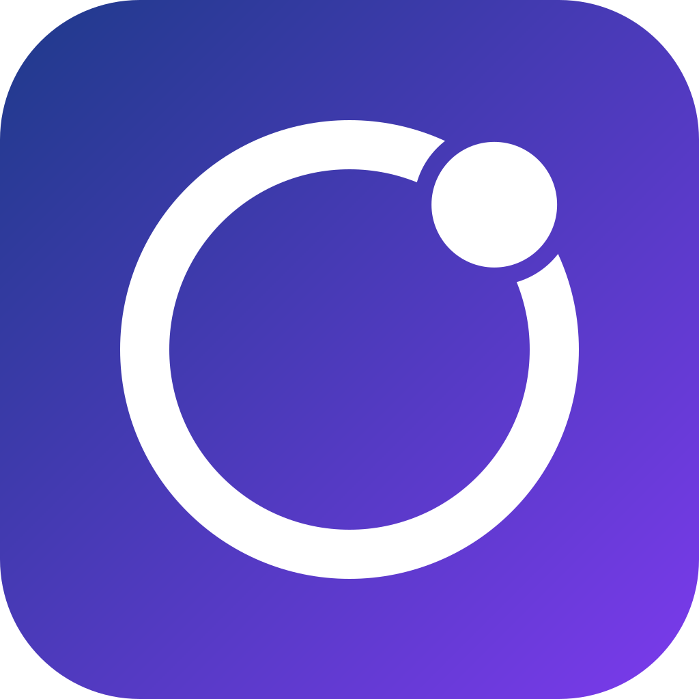
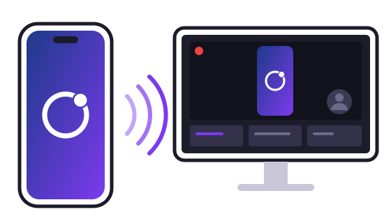

<h1 align="center">MirrorLoop</h1>

Lo schermo dell'iPhone sul PC, pronto per OBS.

  <a href="https://andreitelea.github.io/mirrorloop/it/">Sito</a> ·
  <a href="https://andreitelea.github.io/mirrorloop/it/guida.html">Guida</a> ·
  <a href="https://github.com/andreitelea/mirrorloop/releases">Download</a> ·
  <a href="https://andreitelea.github.io/mirrorloop/it/supporto.html">Supporto</a> ·
  <a href="https://andreitelea.github.io/mirrorloop/it/privacy.html">Privacy</a>

<a href="README.md">English</a> · Italiano

MirrorLoop trasmette lo schermo e l'audio dell'iPhone a un PC Windows sulla rete di casa, con una sorgente per OBS Studio per le dirette. Gratis, senza pubblicità, senza server e senza account.

> **Stato:** anteprima 0.14.0. Il programma per Windows e il plugin per OBS si scaricano dalla pagina delle [Release](https://github.com/andreitelea/mirrorloop/releases). **L'app per iPhone non è ancora disponibile al pubblico:** arriverà presto sull'App Store.

## Cosa fa

- Trasmette **schermo e audio** dell'iPhone al PC, sincronizzati, anche con l'app in background.
- Tre qualità: **HD** (720p, 30 fps), **Full HD** (1088p, 60 fps, predefinita) e **Massima** (la risoluzione esatta dello schermo dell'iPhone, 60 fps).
- **Abbinamento** al primo collegamento: un codice di 6 cifre compare sull'iPhone e sul PC e va confermato su entrambi. Dopo, l'iPhone si ricollega da solo.
- Collegamento **cifrato** (QUIC), solo sulla rete di casa.
- **Sorgente "MirrorLoop" per OBS Studio**, con video e audio: niente "Cattura finestra".

## Cosa serve

- iPhone con **iOS 27** o successivo.
- PC con **Windows 11** a 64 bit.
- iPhone e PC sulla **stessa rete di casa**, impostata in Windows come rete **Privata** (se è Pubblica il ricevitore lo segnala).
- Per le dirette: **OBS Studio 31.1** o successivo.
- Consiglio: Wi-Fi a 5 GHz con l'iPhone vicino al router, e il PC collegato con il cavo. La qualità Massima vuole un buon segnale.

## Per cominciare

1. Scarica `MirrorLoop-<versione>-Windows.exe` dall'ultima [Release](https://github.com/andreitelea/mirrorloop/releases) e aprilo. L'installatore non è ancora firmato digitalmente, quindi Windows può mostrare **"Windows ha protetto il PC"**: scegli *Ulteriori informazioni* → *Esegui comunque*. Installa il **ricevitore** e, se vuoi, il **plugin per OBS**.
2. Sul PC apri **MirrorLoop** dal menu Start. Premi **F1** per vedere i tasti.
3. Sull'iPhone apri l'app, scegli il PC nell'elenco e tocca **Avvia la trasmissione**.
4. Sull'iPhone e sul PC compare lo stesso codice di 6 cifre: se coincide, tocca **Il codice coincide** sull'iPhone e premi **Consenti** sul PC.
5. In OBS aggiungi una sorgente **MirrorLoop** alla scena.

L'installatore aggiunge anche la regola del firewall che apre la porta UDP 7450 **solo sulle reti private**. Si disinstalla da *Impostazioni → App*. Chi vuole solo il plugin per OBS può scaricare `MirrorLoop-<versione>-plugin-OBS.zip` ed estrarre la cartella `mirrorloop` in `C:\ProgramData\obs-studio\plugins\`.

Tutti i dettagli, compreso il monitoraggio dell'audio in OBS, sono nella [guida passo passo](https://andreitelea.github.io/mirrorloop/it/guida.html). Qualcosa non va? Guarda i [problemi comuni](https://andreitelea.github.io/mirrorloop/it/supporto.html#problemi) o [apri una issue](https://github.com/andreitelea/mirrorloop/issues/new/choose).

## Privacy

MirrorLoop non ha server e non raccoglie dati: immagini e audio vanno direttamente dall'iPhone al PC, dentro la rete di casa, e non passano da Internet. Dettagli nell'[informativa sulla privacy](https://andreitelea.github.io/mirrorloop/it/privacy.html).

## Come funziona

- **iPhone** (`ios/`): cattura lo schermo con ScreenCaptureKit, comprime il video in H.264 con VideoToolbox e trasmette video e audio con QUIC (Network.framework). Il PC si trova da solo con Bonjour.
- **PC Windows** (`windows/`): il ricevitore, in C# con .NET 10, decomprime il video con Media Foundation, suona l'audio e mostra l'immagine; scrive immagini e audio in una memoria condivisa per OBS.
- **OBS** (`obs/`): il plugin legge la memoria condivisa e la offre come sorgente.

Documenti tecnici: [protocollo di rete](docs/protocollo.md) (compreso l'abbinamento) e [memoria condivisa per OBS](docs/memoria-condivisa.md).

## Per sviluppare

- Windows con [SDK di .NET 10](https://dotnet.microsoft.com/download) e Git. Ricevitore e test: `dotnet build windows/MirrorLoop.slnx -c Release` e `dotnet test windows/MirrorLoop.slnx -c Release`.
- Per il plugin OBS (`obs/`): Visual Studio 2022 (anche solo Build Tools) con il carico di lavoro C++ e CMake 3.30 o successivo; si compila con `cmake --preset windows-x64` e `cmake --build --preset windows-x64` dentro `obs/`.
- L'app iOS (`ios/`) non richiede un Mac: il progetto Xcode si genera con [XcodeGen](https://github.com/yonaskolb/XcodeGen) e il workflow `.github/workflows/ios.yml` lo compila su macOS con GitHub Actions. Le build del ramo `main` vengono firmate e caricate su TestFlight.
- **Rilascio per Windows:** la versione è una sola per app, ricevitore e plugin (`ios/project.yml`, `windows/src/MirrorLoop.Ricevitore/MirrorLoop.Ricevitore.csproj`, `obs/buildspec.json`). Pubblicando un tag `v<versione>` il workflow `.github/workflows/rilascio.yml` costruisce l'installatore ([Inno Setup](https://jrsoftware.org/isinfo.php), `windows/installatore/`) e lo zip del plugin e prepara una Release in bozza.

## Licenza

[MIT](LICENSE), tranne la cartella `obs/` (plugin per OBS Studio), che è [GPL-2.0](obs/LICENSE) come OBS stesso.
